<picture>
  <source media="(min-width: 1012px) and (prefers-color-scheme: dark)" srcset="assets/header-dark.svg">
  <source media="(min-width: 1012px) and (prefers-color-scheme: light)" srcset="assets/header-light.svg">
  <source media="(prefers-color-scheme: dark)" srcset="assets/header-phone-dark.svg">
  <source media="(prefers-color-scheme: light)" srcset="assets/header-phone-light.svg">
  
</picture>

  <picture>
    <source media="(min-width: 1012px) and (prefers-color-scheme: dark)" srcset="assets/stack-dark.svg">
    <source media="(min-width: 1012px) and (prefers-color-scheme: light)" srcset="assets/stack-light.svg">
    <source media="(prefers-color-scheme: dark)" srcset="assets/stack-phone-dark.svg">
    <source media="(prefers-color-scheme: light)" srcset="assets/stack-phone-light.svg">
    
  </picture>

Software engineer in New York. I use AI to ship fast, and I read what it writes well enough to change it by hand. Lately that's [Megatron](https://github.com/Megatron-HQ/Megatron), an open-source desktop app for Claude Code skills with 40+ users; an MCP server that lets non-technical staff query a data warehouse in plain English; and a multi-agent workflow that halved my team's time per ticket.

open to full-time SWE roles · NYC or Bay Area 
[heysai.dev](https://heysai.dev) · [linkedin](https://www.linkedin.com/in/sai-rithik-engineer/) · [sairithik8639@gmail.com](mailto:sairithik8639@gmail.com)
